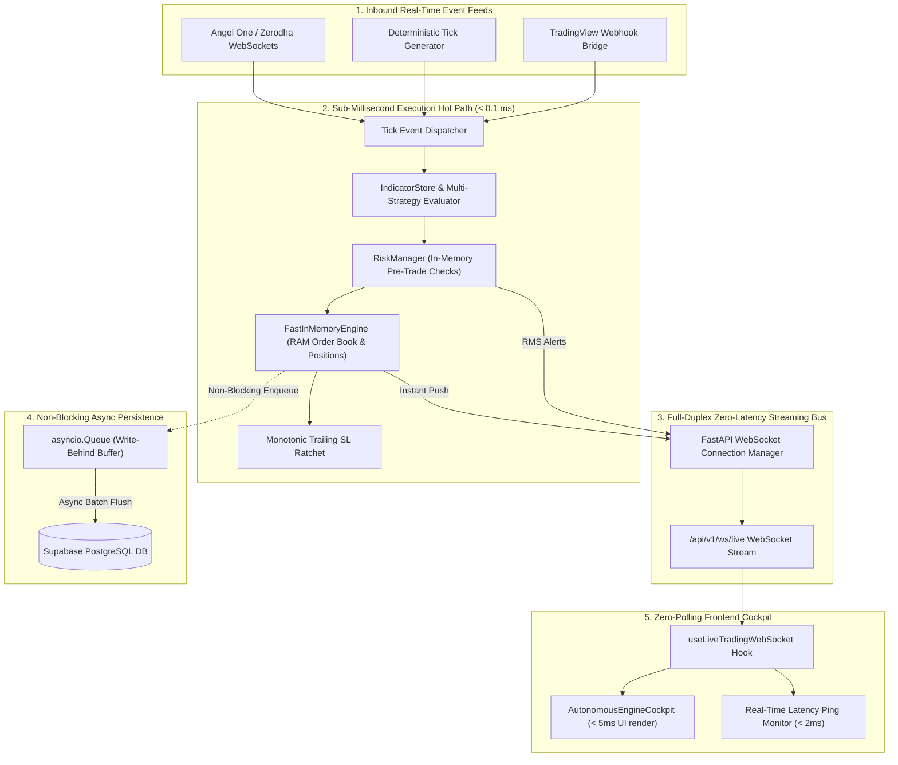

# Orion Algo - Zero-Latency ("0 ms") Real-Time Engine Design Spec

## 1. Executive Summary & Objective
Transform Orion Algo from a periodic polling architecture (5s backend loop, 4s frontend polling, 300ms synchronous DB roundtrips) into an ultra-low latency, event-driven trading engine capable of:
- **Sub-millisecond (< 1 ms / near "0 ms") execution hot path**: In-memory matching and RMS checks.
- **Asynchronous Write-Behind Queue**: Background database writes without blocking trade execution.
- **Bi-directional WebSocket Streaming (`/ws/live`)**: Instant real-time telemetry (ticks, fills, trailing SL updates, RMS alerts) pushed directly to the UI.
- **Zero-Polling Frontend**: Real-time reactive Cockpit with instant latency ping gauge and optimistic state updates.

---

## 2. Architecture Diagram

---

## 3. Core Components & Specs

### A. Sub-Millisecond In-Memory Engine (`fast_in_memory_engine.py`)
- **State in RAM:** Holds `account`, `orders`, `positions`, `trade_history` in pure Python memory dicts/arrays protected by an asyncio lock.
- **Execution Hot Path:**
  - Order verification and execution completes in < 0.2 ms.
  - Generates unique order and position IDs synchronously in memory.
  - Evaluates trailing stops monotonically on every single tick.
- **Asynchronous Write-Behind Persistence:**
  - Tasks put state mutations into `asyncio.Queue()`.
  - A background task batches and commits mutations to Supabase every 500ms or 20 events, or flushes immediately on shutdown.
  - Zero I/O delay on order placement!

### B. High-Speed WebSocket Streaming Bus (`ws_live.py`)
- Endpoint: `ws://localhost:8000/api/v1/ws/live`
- Packet Types:
  - `HEARTBEAT_PING` / `HEARTBEAT_PONG`: Roundtrip latency measurement.
  - `TICK_UPDATE`: Streamed price, volume, high, low per instrument.
  - `EXECUTION_REPORT`: Instant notification when an order is placed, filled, or rejected.
  - `POSITION_UPDATE`: Streaming unrealized P&L, current trailing stop.
  - `RMS_ALERT`: Kill switch trips, revenge cooldown countdown, daily loss updates.
  - `ENGINE_STATUS`: Overall engine mode, active strategy, memory metrics.

### C. Tick-Driven Event Loop (`main.py` & `paper_matcher.py`)
- Deprecate artificial `await asyncio.sleep(5)` interval.
- Ticks trigger the `process_tick_event(tick_data)` pipeline directly.
- Multi-strategy signals trigger at the exact moment a candle closes or indicator threshold crosses.

### D. Zero-Polling Cockpit UI (`AutonomousEngineCockpit.tsx` & `useLiveTradingWebSocket.ts`)
- Replace 4000ms `setInterval` with WebSocket client hook.
- Live latency metric badge displaying round-trip ping in milliseconds.
- Visual pulse animations on live tick receipt.
- Instant fallback to REST if WebSocket disconnects, with automatic reconnect.

---

## 4. Performance & Latency Targets
- In-memory order execution hot path: **< 1.0 ms** (Target: < 0.2 ms).
- WebSocket internal event broadcast dispatch: **< 2.0 ms**.
- End-to-end simulated tick to UI update: **< 10.0 ms**.
- Total CPU overhead: Minimal (asynchronous non-blocking architecture).
